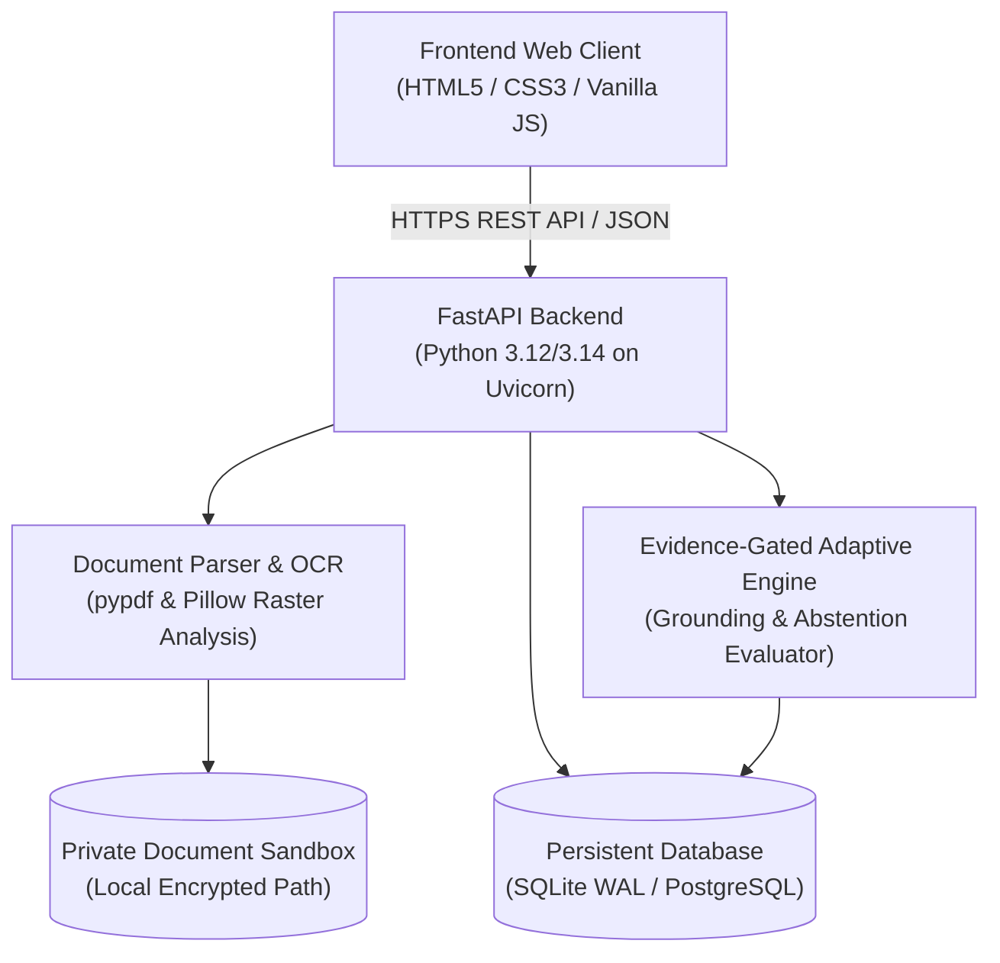

# PathoGuard-AI — System Architecture & Component Inventory

---

## 1. Architectural Layers

### A. Presentation Layer (`PathoGuard-AI-Frontend/`)
- **Design System:** Direction A Clinical Intelligence theme (Midnight Navy `#101B2A`, Slate Teal `#263E4B`, Mint Green `#A7F3D0`, Manrope/Inter typography).
- **Core Views:**
  - `view-dashboard`: Overview metrics, recent activities, quick intake launches.
  - `view-symptoms`: Step-by-step adaptive symptom questionnaire with sensitive information "Why We Ask" callouts.
  - `view-reports`: Side-by-side split reader (original document vs parsed findings), OCR text correction modal, evidence search bar, and patient-friendly AI translation drawer.
  - `view-results`: Evidence synthesis matrix, discordance highlights, doctor visit questions, and clinical next steps.
  - `view-history`: Relational assessment history timeline, search & filter controls, and side-by-side assessment comparison modal.
  - `view-settings`: API connection diagnostics, session sandbox purge, and live AI reliability benchmark runner.
- **Centralized API Client (`api.js`):** Singleton client managing base URLs, request timeouts, error handling, offline transitions, and health status broadcasting.

### B. Application & Engine Layer (`PathoGuard-AI-Backend/app/`)
- **`app/api/v1/`**: RESTful API endpoints for health probes, dashboard metrics, assessments, report upload & verification, report understanding, and AI benchmarking.
- **`app/engine/adaptive_engine.py`**: Adaptive Assessment Engine that evaluates symptoms, detects discordances, flags red flags, and generates targeted follow-up questions.
- **`app/engine/abstention_rules.py`**: Abstention Evaluator with rules blocking autonomous cancer diagnosis (`AUTONOMOUS_DIAGNOSIS_UNSUPPORTED`) and longitudinal progression fallacies (`LONGITUDINAL_PROGRESSION_UNSUPPORTED`).
- **`app/engine/report_explainer.py`**: Grounded report explainer organizing verified reports into 4 clinical sections (`technique`, `findings`, `impression`, `recommendations`) and tagging verbatim vs AI content.
- **`app/engine/terminology_explainer.py`**: Evidence-grounded dictionary providing definitions, clinical context, common misconceptions, and suggested doctor questions.

### C. Data & Storage Layer (`PathoGuard-AI-Backend/app/db/` & `uploads/`)
- **Relational Storage:** Persistent SQLite database in WAL mode (`pathoguard.db`) with automatic schema initialization and index optimization; fully compatible with PostgreSQL via connection configuration.
- **Privacy Sandbox:** Isolated directory (`uploads/sandbox/`) with 25MB file limits, path traversal sanitization, and manual/session purge mechanisms.

---

## 2. Component Inventory

| Module Path | Responsibility | Primary Dependencies |
|---|---|---|
| `main.py` | Application entrypoint, CORS, security headers, exception handling | FastAPI, Starlette |
| `app/core/config.py` | Environment configuration, validation, security settings | pydantic-settings |
| `app/services/document_parser.py` | Multi-page digital PDF text extraction, raster analysis | pypdf, Pillow |
| `app/services/file_manager.py` | Sandbox file persistence, filename sanitization, size limits | Built-in os/uuid |
| `app/db/repository.py` | CRUD operations, full-text search, assessment comparison, duplicate checks | sqlite3 |
| `app/evaluations/benchmark_runner.py` | AI evaluation harness, metrics calculation, report generator | Built-in json |
